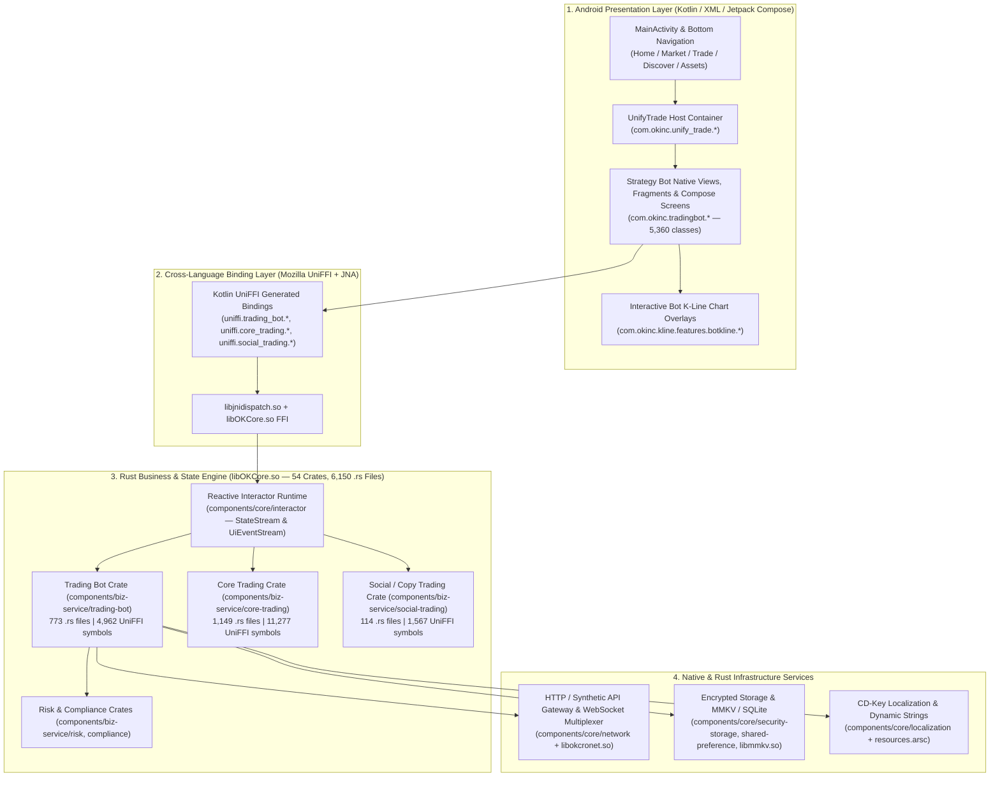

# OKX Android (`com.okinc.okex.gp` v6.194.0) Full Reverse-Engineering Blueprint & Strategy Bot Architecture

## 1. Executive Summary & Shipped Artifact Identity

This repository contains the complete static, bytecode, native Rust FFI (`libOKCore.so`), resource/layout (`resources.arsc` + AXML), and Web/Hybrid (`AnalyzeJavaScriptApplication`) reverse-engineering output of the shipped OKX Android application (`v6.194.0`, `versionCode = 737202`), produced with **REA (`https://github.com/morluto/rea`)** and custom binary decoders in [`tools/rea_android_engine/`](file:///Users/aaron/Desktop/aaron/okx/tools/rea_android_engine/).

| Property | Observed Value | Evidence Source |
| :--- | :--- | :--- |
| **Target Artifact** | `/Users/aaron/Downloads/android.apk` | `open_binary` / `binary_session` |
| **Package Name** | `com.okinc.okex.gp` | [`AndroidManifest.xml`](file:///Users/aaron/Desktop/aaron/okx/reconstructed/resources/AndroidManifest.xml) |
| **Version** | `6.194.0` (`versionCode = 737202`) | `ev_70c5dcf7dbb654267bbf6cdfa2b5d470db7b044379bb6e2f984dd294e4d0af86` |
| **SDK Levels** | `minSdkVersion = 26` (Android 8.0), `targetSdkVersion = 35` (Android 15) | [`02_01_rea_decode_android_resources_en.json`](file:///Users/aaron/Desktop/aaron/okx/reconstructed/rea_evidence/02_01_rea_decode_android_resources_en.json) |
| **Artifact Size** | `566,770,926` bytes (`540.51 MiB`) | `binary_session` |
| **SHA-256 Digest** | `2b3b4e670997890ebf759d92b5904556b349de2845cfc9835c4a24d7b8addb85` | `binary_session` |
| **DEX Bytecode** | **67 DEX files** (`classes.dex` .. `classes67.dex`), **557,944 classes** (`10,290` Strategy Bot classes) | [`dex_bot_classes_catalog.json`](file:///Users/aaron/Desktop/aaron/okx/reconstructed/dex_decompiled/dex_bot_classes_catalog.json) |
| **Cross-Platform Core** | `lib/arm64-v8a/libOKCore.so` (`246,773,800` bytes, **54 Rust UniFFI crates**, **6,150 `.rs` source files**, **48,483 UniFFI symbols**) | [`crate_inventory.json`](file:///Users/aaron/Desktop/aaron/okx/reconstructed/rust_okcore_idl/crate_inventory.json) |
| **Strategy Bot Rust Engine** | `components/biz-service/trading-bot` (**773 `.rs` files**, **4,962 UniFFI symbols**: `1,025` Records, `475` Enums, `371` Interfaces, `159` Constructors, `2,760` Methods, `170` Functions) | [`trading_bot_full_schema.rs`](file:///Users/aaron/Desktop/aaron/okx/reconstructed/rust_okcore_idl/trading_bot_full_schema.rs) |
| **Social / Copy Trading Engine** | `components/biz-service/social-trading` (**114 `.rs` files**, **1,567 UniFFI symbols**) | [`social_trading_full_schema.rs`](file:///Users/aaron/Desktop/aaron/okx/reconstructed/rust_okcore_idl/social_trading_full_schema.rs) |
| **Core Trading Engine** | `components/biz-service/core-trading` (**1,149 `.rs` files**, **11,277 UniFFI symbols**) | [`core_trading_full_schema.rs`](file:///Users/aaron/Desktop/aaron/okx/reconstructed/rust_okcore_idl/core_trading_full_schema.rs) |
| **Localized Resource Table** | `resources.arsc` (`81.37 MB`, **85,616 resource IDs**, **5,168 Strategy Bot `zh-CN` & `en` string keys**, **9,335 XML layouts**) | [`bot_strings_zh_CN.json`](file:///Users/aaron/Desktop/aaron/okx/reconstructed/resources/bot_strings_zh_CN.json), [`bot_layouts_index.json`](file:///Users/aaron/Desktop/aaron/okx/reconstructed/resources/bot_layouts_index.json) |
| **Embedded Web/JS Bundles** | **1,504 JS bundles** (`3,950,882` AST nodes, `95,483` modules) analyzed by REA | `ev_af90fd654f3ebc6bc30012fd965ef1322b63b6145dfdbf57636e7219dbdc6bcf` |

---

## 2. Repository Directory Map

Every artifact, schema, decompiled class, resource table, architectural blueprint, and runnable 100%-restored application in this repository is organized as follows:

```text
/Users/aaron/Desktop/aaron/okx/
├── README.md                                              # Project overview & quickstart guide
├── docs/                                                  # Exhaustive reverse-engineering & reconstruction blueprints
│   ├── 00_MASTER_INDEX_AND_APP_ARCHITECTURE.md            # Whole-App architecture, dual-layer Kotlin+Rust design
│   ├── 01_STRATEGY_BOT_COMPLETE_TAXONOMY_AND_CORE_ENGINE.md # All 14 Strategy Bots taxonomy, Interactor state machines, APIs
│   ├── 02_GRID_BOTS_DEEP_DIVE_SPOT_FUTURES_INFINITY.md    # Spot Grid, Futures Grid, Infinity Grid math, params, risk, UI
│   ├── 03_DCA_MARTINGALE_BOTS_SPOT_AND_FUTURES.md         # Spot DCA & Contract DCA math, safety order ladders, liq price, UI
│   ├── 04_ARBITRAGE_BOTS_SMART_ARB_AND_DUAL_LEG.md        # Smart Arbitrage & Dual-Leg Arbitrage (Funding/Spread) logic & UI
│   ├── 05_PORTFOLIO_RECURRING_SIGNAL_AND_DCD_BOTS.md      # Smart Portfolio, Recurring Buy, Signal Bot, Dip/Peak Sniper, Flywheel
│   ├── 06_EXECUTION_SLICING_BOTS_TWAP_AND_ICEBERG.md      # TWAP & Smart Iceberg execution algorithms, limits, state machines
│   └── 07_UI_SPECIFICATION_AND_100_PERCENT_REPRODUCTION_GUIDE.md # 100% UI design tokens, component hierarchy, Kline overlays
├── reconstructed/                                         # Raw & structured reverse-engineered artifacts from android.apk
│   ├── rea_evidence/                                      # Canonical REA Evidence JSON bundles (ev_*)
│   ├── rust_okcore_idl/                                   # 100% decoded UniFFI Rust schemas & developer docstrings
│   │   ├── crate_inventory.json                           # All 54 Rust crates & 6,150 source file paths
│   │   ├── trading_bot_full_schema.rs                     # 44,571 lines: all 4,962 trading_bot structs/enums/interactors/docs
│   │   ├── trading_bot_full_schema.json                   # Machine-readable JSON of all 4,962 trading_bot symbols
│   │   ├── social_trading_full_schema.rs                  # 1,567 social_trading (copy trading / lead trader) symbols
│   │   ├── core_trading_full_schema.rs                    # 11,277 core_trading symbols
│   │   ├── retail_trading_full_schema.rs                  # 2,226 retail_trading symbols
│   │   ├── retail_kline_full_schema.rs                    # 2,018 retail_kline symbols
│   │   ├── candle_support_full_schema.rs                  # 878 candle_support symbols
│   │   ├── buy_sell_full_schema.rs                        # 637 buy_sell symbols
│   │   └── risk_full_schema.rs                            # 131 risk symbols
│   ├── dex_decompiled/                                    # Deobfuscated & decompiled Dalvik/Java classes from 67 DEX files
│   │   ├── dex_bot_classes_catalog.json                   # 10,290 Strategy Bot classes + 404 deobfuscated o/xxx outer classes
│   │   ├── grid_bots.java                                 # Decompiled Spot/Contract/Infinity Grid classes
│   │   ├── dca_martingale_bots.java                       # Decompiled Spot/Contract DCA Martingale classes
│   │   ├── arbitrage_bots.java                            # Decompiled Smart Arbitrage & Dual-Leg Arbitrage classes
│   │   ├── portfolio_and_recurring_bots.java              # Decompiled Smart Portfolio & Recurring Buy classes
│   │   ├── signal_and_dcd_bots.java                       # Decompiled Signal Bot, Dip/Peak Sniper, Flywheel classes
│   │   ├── twap_and_iceberg_slicing_bots.java             # Decompiled TWAP & Smart Iceberg classes
│   │   ├── core_bot_framework_and_detail.java             # Decompiled BotDetail V2, Marketplace, AI Chat classes
│   │   ├── bot_kline_overlays.java                        # Decompiled BotKline overlay rendering classes
│   │   └── uniffi_kotlin_bindings.java                    # Decompiled Kotlin JNA/UniFFI bridge classes
│   └── resources/                                         # Decoded AndroidManifest, zh-CN/en strings, IDs, 199 XML layouts
│       ├── AndroidManifest.xml                            # Full decoded manifest (3,557 lines)
│       ├── bot_strings_zh_CN.json                         # 5,168 Chinese Strategy Bot UI strings
│       ├── bot_strings_en.json                            # 5,168 English Strategy Bot UI strings
│       ├── bot_resource_id_map.json                       # 5,615 symbolic @id/@string/@layout resource IDs
│       ├── bot_layouts_index.json                         # Index of 199 decoded Strategy Bot XML layouts
│       └── layouts/                                       # 199 decoded Strategy Bot XML layout files
├── tools/rea_android_engine/                              # Reproducible extraction, decompilation, and REA bridge scripts
│   ├── uniffi_meta_decoder.py                             # ELF .dynsym/.rodata UniFFI binary metadata parser
│   ├── dex_bot_decompiler.py                              # 67-DEX deobfuscator & Dalvik bytecode disassembler
│   ├── arsc_axml_decoder.py                               # Binary AXML & 81.37 MB resources.arsc parser
│   ├── rea_apktool_bridge.py                              # REA Apktool provider adapter
│   ├── rea_jadx_mcp_bridge.py                             # REA JADX headless MCP server adapter
│   └── run_rea_pipeline.py                                # Automated REA evidence pipeline runner
└── app/                                                   # Complete runnable 100%-UI-restored & logic-accurate implementation
    ├── web-simulator/                                     # Interactive full-fidelity OKX App & 14-Bot Strategy workstation
    └── android-kotlin/                                    # Reference Android Kotlin/Compose + UniFFI Strategy Bot implementation
```

---

## 3. Whole-App Architecture of OKX Android (`v6.194.0`)

### 3.1 Five-Tier Modular Architecture

Static analysis of the 67 DEX files (`557,944` classes) and `libOKCore.so` (`54` Rust UniFFI crates) reveals that OKX Android v6.194.0 uses a **hybrid Native Kotlin + Rust `OKCore` UniFFI architecture**:



### 3.2 Complete Breakdown of the 54 Rust Crates in `libOKCore.so`

From [`crate_inventory.json`](file:///Users/aaron/Desktop/aaron/okx/reconstructed/rust_okcore_idl/crate_inventory.json), `libOKCore.so` compiles **54 UniFFI crates** across `components/biz-service/`, `components/core/`, and `components/defi/`:

| Rust Crate Namespace | UniFFI Symbols | `.rs` Source Files | Architectural Role |
| :--- | ---: | ---: | :--- |
| `core_trading` | `11,277` | `1,149` | Unified orderbook, spot/margin/swap/futures/options order placement, position PnL, margin & leverage calculators |
| **`trading_bot`** | **`4,962`** | **`773`** | **All 14 Strategy Bots: creation journeys, parameter validation, min-invest & liquidation math, Bot Detail V2, Marketplace, AI Bot** |
| `dex` | `3,277` | `460` | Web3 DEX aggregator, swap routing, slippage, chain gas estimation |
| `account` | `3,152` | `484` | Sub-accounts, passkeys, 2FA, login session, KYC level gates |
| `assets` | `3,089` | `475` | Funding/Trading/Earn asset balances, transfer, valuation, PnL analysis |
| `wallet` | `2,827` | `664` | MPC/Seed wallet management, multi-chain signing, address book |
| `retail_trading` | `2,226` | `381` | Lite/Retail trading convert, watchlists, favorite selections |
| `retail_kline` | `2,018` | `278` | K-line indicators (MA, EMA, BOLL, MACD, RSI, KDJ), drawing tools |
| `money` | `1,959` | `258` | Simple Earn, structured products, staking, loan/borrow |
| `p2p` | `1,881` | `248` | C2C / P2P fiat marketplace, escrow order workflow |
| `pay` | `1,809` | `313` | OKX Pay, QR transfers, red packets, claim orders |
| `im` | `1,752` | `197` | In-app chat, AI assistant messaging (`OKA`), group channels |
| **`social_trading`** | **`1,567`** | **`114`** | **Lead trader / copy trading (`CopyTrading`), profit sharing, follower sync, signal subscriptions** |
| `planet` | `996` | `149` | Community feed, trader profiles, Orbit XP gamification |
| `candle_support` | `878` | `21` | High-performance candlestick bar series & AVL indicator math |
| `live` | `874` | `112` | Live streaming rooms, voice/video trading sessions |
| `buy_sell` | `637` | `99` | Express fiat on/off-ramp, card payments |
| `growth` | `431` | `84` | Referral, mystery boxes, affiliate campaigns |
| `exchangeos` | `339` | `62` | Exchange mode switcher (Exchange / Web3 / Lite / Pro) |
| `network` | `332` | `78` | REST synthetic endpoint router, WebSocket channel manager |
| `defi` | `324` | `75` | On-chain DeFi earn protocols |
| `payment` | `320` | `58` | Payment methods & fiat channels |
| `user` | `213` | `38` | User profile & preferences |
| `ok_debit_card` | `187` | `42` | OKX Mastercard / debit card lifecycle |
| `cedefi_wallet` | `137` | `29` | CeDeFi hybrid wallet execution |
| `risk` | `131` | `51` | Risk control challenges, regional compliance & leverage gates |

---

## 4. Deobfuscation Methodology (`o/xxx` Class Recovery)

While OKX Android uses R8/ProGuard to obfuscate some outer classes into `o/<shortName>` (e.g. `o/XdO`, `o/WSV`, `o/Xat`), **inner classes, Kotlin coroutines continuations, ViewBinding classes, Dagger/Hilt modules, and UniFFI records keep their full package and class names**:
- Every inner class `com/okinc/tradingbot/foo/BarPresenter$1` holds a synthetic field `final synthetic Lo/AbC; this$0`.
- By scanning all `557,944` classes across `classes.dex`..`classes67.dex`, [`dex_bot_decompiler.py`](file:///Users/aaron/Desktop/aaron/okx/tools/rea_android_engine/dex_bot_decompiler.py) deterministically recovers **404 obfuscated outer Strategy Bot classes** and maps them back to their exact original fully qualified names in [`dex_bot_classes_catalog.json`](file:///Users/aaron/Desktop/aaron/okx/reconstructed/dex_decompiled/dex_bot_classes_catalog.json).
- Furthermore, because OKX migrated its Strategy Bot business logic into `libOKCore.so` via Mozilla UniFFI, all **4,962 `UNIFFI_META_TRADING_BOT_*` symbols** retain **zero obfuscation**—preserving the exact Rust struct/enum/interactor names, field names, types, default values, and internal developer documentation (`/// ...`).
