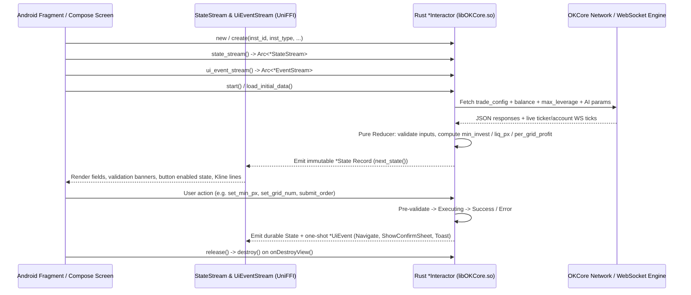

# OKX Strategy Bot (`trading-bot`) Complete Taxonomy, Reactive Interactor Engine & API Specification

## 1. Complete Taxonomy of All 14 Strategy Bots in OKX v6.194.0

Based on static analysis of [`trading_bot_full_schema.rs`](file:///Users/aaron/Desktop/aaron/okx/reconstructed/rust_okcore_idl/trading_bot_full_schema.rs), [`dex_bot_classes_catalog.json`](file:///Users/aaron/Desktop/aaron/okx/reconstructed/dex_decompiled/dex_bot_classes_catalog.json), and [`bot_strings_zh_CN.json`](file:///Users/aaron/Desktop/aaron/okx/reconstructed/resources/bot_strings_zh_CN.json), OKX Android v6.194.0 implements **14 Strategy Bot types** grouped into **4 Marketplace Categories**:

| # | Wire `ordType` / `stgyType` | Chinese Name (`zh-CN`) | English Name (`en`) | Category Tab | Supported `instType` | Core Rust Module (`components/biz-service/trading-bot/src/`) | Native Android Package (`com.okinc.tradingbot.*`) |
| :-: | :--- | :--- | :--- | :--- | :--- | :--- | :--- |
| **1** | `grid` | **现货网格** | **Spot Grid** | 网格策略 (Grid) | `SPOT` | `grid/spot_grid/`, `grid/spot_grid_easy/`, `grid/spot_grid_copy_clone/` | `grid.spot.*`, `impl.order.strategy.grid.*` |
| **2** | `contract_grid` | **合约网格** | **Futures Grid** | 网格策略 (Grid) | `SWAP`, `FUTURES` | `grid/contract_grid/` | `grid.contract.*`, `unify_trade.bot.grid.*` |
| **3** | `moon_grid` / `infinity_grid` | **天地网格** | **Infinity Grid** | 网格策略 (Grid) | `SPOT` | `grid/common/` | `impl.order.strategy.grid.infinity.*` |
| **4** | `spot_dca` | **现货马丁格尔 (现货DCA)** | **Spot DCA (Martingale)** | 马丁格尔 / 定投 (DCA) | `SPOT` | `dca/spot/` | `dcabot.spot.*` |
| **5** | `contract_dca` | **合约马丁格尔 (合约DCA)** | **Futures DCA (Martingale)** | 马丁格尔 / 定投 (DCA) | `SWAP`, `FUTURES` | `dca/contract/` | `dcabot.contract.*` |
| **6** | `smart_arb` | **屯币套利 / 智能套利** | **Smart Arbitrage** | 套利策略 (Arbitrage) | `SPOT` + `SWAP` | `smart_arbitrage/` | `smartarb.*` |
| **7** | `arbitrage` | **套利下单 (资金费率/期现/期期)** | **Arbitrage Order** | 套利策略 (Arbitrage) | `SPOT` / `MARGIN` / `SWAP` / `FUTURES` | `arbitrage/` | `arbitrage.*` |
| **8** | `smart_portfolio` | **屯币宝** | **Smart Portfolio** | 组合 / 定投 (Portfolio) | `SPOT` (2–10 coins) | `smart_portfolio/` | `portfolio.*` |
| **9** | `recurring` | **定投策略** | **Recurring Buy** | 组合 / 定投 (DCA) | `SPOT` (1–20 coins) | `recurring_buy/` | `recurring.*` |
| **10** | `signal` | **信号策略** | **Signal Bot** | 信号 / 结构化 (Signal) | `SWAP`, `FUTURES` | `signal_bot/`, `signal_square/` | `signal.*` |
| **11** | `dcd_dip` / `dcd_peak` | **抄底宝 / 逃顶宝** | **Dip Sniper / Peak Sniper** | 信号 / 结构化 (DCD) | `OPTION` / Dual-Currency | `dcd/place_order/`, `dcd/product_detail/`, `dcd/detail/` | `dcd.*`, `sniper.*` |
| **12** | `flywheel` | **飞轮策略** | **Flywheel Bot** | 信号 / 结构化 (DCD) | `OPTION` / Dual-Currency | `dcd/`, `ai_recommend/` | `dcd.flywheel.*` |
| **13** | `twap` | **时间加权委托 (TWAP)** | **TWAP** | 大单拆分 (Slicing) | `SPOT`, `MARGIN`, `SWAP`, `FUTURES` | `twap/place_order/`, `twap/detail/`, `twap/modify_order/` | `twap.*` |
| **14** | `iceberg` | **冰山委托 / 智能冰山** | **Smart Iceberg** | 大单拆分 (Slicing) | `SPOT`, `MARGIN`, `SWAP`, `FUTURES` | `smart_iceberg/create_journey/`, `smart_iceberg/detail/` | `iceberg.*` |

In addition to the 14 strategy execution types, the `trading-bot` crate ships **3 cross-bot platform subsystems**:
1. **AI Strategy Bot & Conversational LLM Assistant (`ai_recommend/`, `aichat/`, `llm_bot_place_order/`)**: Converts natural-language user prompts into parameterized Spot Grid, Futures Grid, Spot DCA, Futures DCA, or Flywheel order cards with 7D/30D/180D backtest metrics and one-tap order placement (`LlmBotPlaceOrderInteractor`).
2. **Bot Marketplace & Copy/Lead Trading (`bot_common/`, `social-trading/`)**: Hosts the Strategy Plaza (策略广场), AI Recommended Zones (`ai_recommend_zones`), Popular Themes (`recurring_popular_themes`), Signal Square (`SignalSquareInteractor`), and Lead Trader Profit-Sharing (`SpotGridCopyCloneInteractor`, `ContractDcaSyncConfirmInteractor`).
3. **Unified Bot Detail V2 & Bot Kline Overlay Engine (`bot_detail/`, `botkline/`)**: Renders running and historical bots with live Overview, Positions, Open Orders, Cycle History, Profit Withdrawal, Margin Adjustment, Parameter Modification, and interactive K-line price-level overlays.

---

## 2. Internal Source Tree of `components/biz-service/trading-bot/src/` (773 `.rs` Files)

Extracted directly from the embedded Rust panic/location descriptors in `libOKCore.so` ([`crate_inventory.json`](file:///Users/aaron/Desktop/aaron/okx/reconstructed/rust_okcore_idl/crate_inventory.json)):

```text
components/biz-service/trading-bot/src/
├── lib.rs
├── core/
│   ├── error.rs                         # OKTSFFIError, BotValidationError
│   ├── model/                           # BotDisplayText, DisplayString, BotSpotInstMeta, BotContractInstMeta
│   ├── network/                         # Synthetic API path definitions & request/response serializers
│   └── utils/                           # Decimal math, rounding, format_util, percentage & precision helpers
├── ai_recommend/                        # AI Tier classification (GridShort/Medium/Long, FlywheelAggressive/Balanced)
├── aichat/                              # AiConversationInteractor, LlmBotPlaceOrderInteractor, indicator cards
├── arbitrage/                           # Dual-leg Funding Rate & Spread Arbitrage (left/right leg, leg chasing)
│   ├── detail/
│   ├── order/
│   └── trade_config/
├── bot_common/                          # OKTSBotCommonService, StrategyRecommendation, voucher & coupon tags
├── dca/                                 # Martingale / DCA Engine
│   ├── common/                          # DcaOrderRequest, DcaTimeline, cycle math, trigger conditions (Instant/Price/RSI)
│   ├── contract/                        # ContractDcaPlaceOrderInteractor, AdjustMargin, AutoMargin, SyncConfirm, LiquidatePrice
│   └── spot/                            # SpotDcaPlaceOrderInteractor, AdditionalFund, EditParams, ManualAddOrder, Timeline
├── dcd/                                 # Dual-Currency Deposit Bots (Dip Sniper, Peak Sniper, Flywheel)
│   ├── detail/                          # DcdDetailJourneyInteractor, ToggleReinvestment, ArbitrageHistory
│   ├── place_order/                     # DcdPlaceOrderInteractor, TargetPrice vs PriceDrop intention modes
│   └── product_detail/                  # DcdProductDetailInteractor, StrikePrice & APY quotes
├── grid/                                # Grid Trading Engine
│   ├── common/                          # GridBotType, GridEditPreviewData, GridProfitRateFetchParams, voucher_tag
│   ├── contract_grid/                   # ContractGridPlaceOrderInteractor, Detail, Edit, Margin, Trailing, LiquidatePrice
│   ├── spot_grid/                       # SpotGridPlaceOrderInteractor, Detail, AdditionalInvestment, EditParams, WithdrawProfit
│   ├── spot_grid_copy_clone/            # SpotGridCopyCloneInteractor (Marketplace copy & parameter cloning)
│   └── spot_grid_easy/                  # SpotGridEasyInteractor (1-click simplified AI tier grid)
├── recurring_buy/                       # Recurring Buy (定投) Engine
│   ├── create/                          # RecurringBuyPlaceOrderInteractor, multi-coin allocation ratios (sum = 100%)
│   ├── detail/                          # RecurringBuyDetailInteractor, Edit, InvestMore, SimpleEarnJourney
│   └── themes/                          # Popular themes & historical backtest curves
├── signal_bot/                          # TradingView / Custom Signal Bot Engine
│   ├── actions/                         # SignalBotActionsInteractor (stop, edit_pairs, edit_tp_sl, manual_place_order)
│   ├── adjust_margin/                   # SignalBotAdjustMarginInteractor
│   ├── create_signal/                   # Custom signal webhook token & alert message generator
│   └── detail/                          # SignalBotDetailInteractor, LeadTrader profile & settlement tabs
├── signal_square/                       # Signal Marketplace (SignalSquareInteractor, Subscribe, Publish)
├── smart_arbitrage/                     # Delta-Neutral Smart Arbitrage Engine
│   ├── condition_modify/                # Open/Close spread control modification
│   ├── detail/                          # SmartArbBotSpecificInfo, PositioningLegDisplay, ProfitDetail, Withdraw
│   └── place_order/                     # SmartArbitragePlaceOrderInteractor, OrderPreview, StopPreview, ReducePosition
├── smart_iceberg/                       # Smart Iceberg Slicing Engine
│   ├── create_journey/                  # Actions, Authority, Presentation, Subscriptions, Validation
│   └── detail/                          # SmartIcebergDetailInteractor, live orders & sub-trades
├── smart_portfolio/                     # Smart Portfolio (屯币宝 Multi-Coin Rebalancing) Engine
│   ├── create/                          # SmartPortfolioCreateInteractor (2-10 coins, Proportional vs Periodic rebalance)
│   └── detail/                          # SmartPortfolioDetailInteractor, TradeGroupList, Rebalance records
└── twap/                                # Time-Weighted Average Price (TWAP) Slicing Engine
    ├── detail/                          # TwapDetailJourneyInteractor, HeaderPresentationV1, SubOrder history
    ├── modify_order/                    # TwapModifyOrderInteractor
    └── place_order/                     # TwapPlaceOrderInteractor (variance, interval, single order limit, min/max math)
```

---

## 3. The Reactive `Interactor` Architecture (UniFFI State & Event Streams)

Every Strategy Bot screen in OKX v6.194.0 is driven by a Rust **Journey Interactor** exported across UniFFI (`UNIFFI_META_TRADING_BOT_INTERFACE_*INTERACTOR`). Understanding this pattern is essential to reconstructing the app:



### Key Architectural Rules Observed in Developer Docstrings (`trading_bot_full_schema.rs`)
1. **Cycle-Free Async Streams (`state_stream()` & `ui_event_stream()`)**:
   - Legacy callback observers (`set_state_observer(Box<dyn Observer>)`) pinned foreign Kotlin/Swift objects in UniFFI's static `handleMap`, creating cross-language GC/ARC retain cycles.
   - All v6.194.0 interactors expose pull-based async streams (`*StateStream::next()`, `*EventStream::next()`) plus an idempotent `release()` method called before `destroy()`.
2. **Zero Hardcoded English Copy in Rust (`DisplayString` & `BotDisplayText`)**:
   - Rust never emits raw English UI strings. Instead, Rust returns typed `DisplayString` / `BotDisplayText` enums (`Plain(String)`, `Placeholder` (`"--"`), or `Localized { key: String, args: Vec<String> }`) referencing resource keys in [`bot_strings_zh_CN.json`](file:///Users/aaron/Desktop/aaron/okx/reconstructed/resources/bot_strings_zh_CN.json) and [`bot_strings_en.json`](file:///Users/aaron/Desktop/aaron/okx/reconstructed/resources/bot_strings_en.json).
3. **Monotonic Action Attempt Counters (`*_attempt: u32`)**:
   - Because UniFFI Record states are immutable on the Kotlin/Swift side, terminal states (`ActionResultState::Success` / `Error`) are paired with a monotonic counter (`stop_attempt`, `submit_attempt`, `edit_tp_sl_attempt`) bumped on every invocation (including pre-validation rejections) so the UI can latch on `(attempt, state)` and never swallow consecutive identical validation errors.

---

## 4. Complete Strategy Bot HTTP & Synthetic API Endpoint Catalog

Extracted from `.rodata` of `libOKCore.so`, the Strategy Bot engine communicates with OKX's backend via **REST `/priapi/v5/algo/...` endpoints** and **OKCore `synthetic://...` internal dispatch routes**:

### 4.1 Grid Bots (Spot Grid, Futures Grid, Infinity Grid)
| Endpoint / Synthetic Route | Method | Purpose |
| :--- | :---: | :--- |
| `/priapi/v5/algo/grid/order-algo` | `POST` | Place Spot Grid / Futures Grid / Infinity Grid order |
| `/priapi/v5/algo/grid/stop-order-algo` | `POST` | Stop running grid bot (sell base coin / close contract position / keep position) |
| `/priapi/v5/algo/grid/min-investment` | `POST` | Compute exact minimum investment & maximum grid quantity for current parameters |
| `/priapi/v5/algo/grid/ai-param` | `GET` | Fetch AI Short/Medium/Long strategy parameters & backtest APY |
| `/priapi/v5/algo/grid/orders-algo-pending` | `GET` | List running grid bots |
| `/priapi/v5/algo/grid/orders-algo-history` | `GET` | List historical stopped grid bots |
| `/priapi/v5/algo/grid/orders-algo-details` | `GET` | Fetch full Bot Detail V2 state for a single `algoId` |
| `/priapi/v5/algo/grid/sub-orders` | `GET` | Fetch live open grid orders & matched arbitrage cycle pairs |
| `/priapi/v5/algo/grid/positions` | `GET` | Fetch Futures Grid contract positions |
| `/priapi/v5/algo/grid/margin-balance` | `POST` | Adjust Futures Grid isolated margin (add / reduce margin) |
| `/priapi/v5/algo/grid/compute-margin-balance` | `POST` | Preview new liquidation price before adding/reducing margin |
| `/priapi/v5/algo/grid/withdraw-income` | `POST` | Withdraw realized grid profits (`SpotGridWithdrawProfitInteractor`) |
| `/priapi/v5/algo/grid/amend-order-algo` | `POST` | Modify TP/SL or grid range (`minPx`, `maxPx`, `gridNum`) while running |
| `/priapi/v5/algo/grid/amend-preview` | `POST` | Preview position delta & estimated close PnL (`GridEditPreviewData`) before amending |
| `/priapi/v5/algo/grid/append-investment` | `POST` | Add additional investment to a running Spot/Futures Grid bot |
| `/priapi/v5/algo/grid/order-instant-trigger` | `POST` | Manually trigger an awaiting-trigger grid bot immediately |

### 4.2 DCA / Martingale Bots (Spot DCA & Futures DCA)
| Endpoint / Synthetic Route | Method | Purpose |
| :--- | :---: | :--- |
| `/priapi/v5/algo/dca/order` | `POST` | Create Spot DCA or Contract DCA bot (`DcaOrderRequest`) |
| `/priapi/v5/algo/dca/stop` | `POST` | Stop DCA bot immediately or at end of current cycle |
| `/priapi/v5/algo/dca/preview-orders` | `POST` | Compute full ladder of Initial + Safety Orders (`dcaPreviewServer`: trigger prices, amounts, liquidation price) |
| `/priapi/v5/algo/dca/detail` | `GET` | Fetch running/history DCA bot detail (`ContractDcaBotInfo` / `SpotDcaBotInfo`) |
| `/priapi/v5/algo/dca/cycles` | `GET` | Fetch completed and active Martingale cycles |
| `/priapi/v5/algo/dca/sub-orders` | `GET` | Fetch sub-orders within a selected Martingale cycle |
| `/priapi/v5/algo/dca/manual-safety-order` | `POST` | Manually place an extra safety order (`SpotDcaManualAddOrderInteractor`) |
| `/priapi/v5/algo/dca/additional-funds` | `POST` | Inject additional funds into a running Spot DCA bot (`AdditionalFundRequest`) |
| `/priapi/v5/algo/dca/edit-params` | `POST` | Edit DCA parameters (`tpPct`, `pxSteps`, `safetyOrdAmt`, `maxSafetyOrds`) for current or next cycle |
| `/priapi/v5/algo/dca/adjust-margin` | `POST` | Add/reduce margin on a Contract DCA bot (`ContractDcaAdjustMarginInteractor`) |
| `/priapi/v5/algo/dca/auto-margin` | `POST` | Configure automatic margin reload (`margin_reload_target_mr`) |

### 4.3 Smart Arbitrage & Dual-Leg Arbitrage Order
| Endpoint / Synthetic Route | Method | Purpose |
| :--- | :---: | :--- |
| `/priapi/v5/algo/smart-arb/products` | `GET` | Fetch Smart Arbitrage coin list, funding rate history, staking APY & combined APY |
| `/priapi/v5/algo/smart-arb/order-preview` | `POST` | Preview Smart Arbitrage dual-leg allocation, fees, and spread conditions |
| `/priapi/v5/algo/smart-arb/order` | `POST` | Create Smart Arbitrage bot (Spot/Staking + Perpetual Swap hedge) |
| `/priapi/v5/algo/smart-arb/stop-preview` | `POST` | Preview closing slippage and redemption rules (`StopAndSell`, `StopNoSell`, `StopKeepStake`) |
| `/priapi/v5/algo/smart-arb/stop` | `POST` | Stop or partially reduce Smart Arbitrage position |
| `/priapi/v5/algo/smart-arb/modify-condition` | `POST` | Modify open/close spread threshold (`arbitrage_condition_modify`) |
| `/priapi/v5/algo/smart-arb/withdraw-profit` | `POST` | Withdraw accumulated funding + staking income |
| `/priapi/v5/algo/arbitrage/order` | `POST` | Place Dual-Leg Arbitrage order (`left_inst_id`, `right_inst_id`, `BuyLong`/`SellShort`, leg chasing) |
| `/priapi/v5/algo/arbitrage/trade-config` | `GET` | Fetch dual-leg tick sizes, lot sizes, and spread calculation rules |

### 4.4 Smart Portfolio, Recurring Buy, Signal Bot, DCD/Flywheel, TWAP & Smart Iceberg
| Endpoint / Synthetic Route | Method | Purpose |
| :--- | :---: | :--- |
| `/priapi/v5/algo/portfolio/order` | `POST` | Create Smart Portfolio multi-coin rebalancing bot (2–10 coins, Periodic vs Proportional) |
| `/priapi/v5/algo/portfolio/min-invest` | `POST` | Compute minimum USDT investment required for selected multi-coin weights |
| `/priapi/v5/algo/recurring/order` | `POST` | Create Recurring Buy plan (hourly/daily/weekly/monthly, 1–20 coins, optional Simple Earn auto-subscribe) |
| `/priapi/v5/algo/recurring/amend` | `POST` | Edit Recurring Buy amount, frequency, time, price range, or pause/resume |
| `/priapi/v5/algo/signal/create-signal` | `POST` | Register custom TradingView webhook signal & generate `signalToken` + alert JSON template |
| `/priapi/v5/algo/signal/order` | `POST` | Start Signal Bot bound to a custom or Signal Square signal |
| `/priapi/v5/algo/signal/square-list` | `GET` | Browse Signal Square marketplace providers |
| `/priapi/v5/algo/dcd/quotes` | `POST` | Request real-time OTC/Options quotes for Dip Sniper / Peak Sniper / Flywheel |
| `/priapi/v5/algo/dcd/order` | `POST` | Subscribe to Dip Sniper, Peak Sniper, or Flywheel (`PlaceDcdOrderInput`) |
| `/priapi/v5/algo/dcd/toggle-reinvest` | `POST` | Toggle auto-reinvestment on an active DCD/Flywheel bot |
| `/priapi/v5/algo/twap/order` | `POST` | Place TWAP time-weighted slicing order |
| `/priapi/v5/algo/twap/amend` | `POST` | Modify running TWAP order parameters (`TwapModifyOrderInteractor`) |
| `/priapi/v5/algo/iceberg/order` | `POST` | Place Smart Iceberg order (`SmartIcebergCreateJourneyInteractor`) |
| `/priapi/v5/algo/ai-chat/conversation` | `POST` | Stream LLM Strategy Bot recommendations & backtest cards (`AiConversationInteractor`) |
